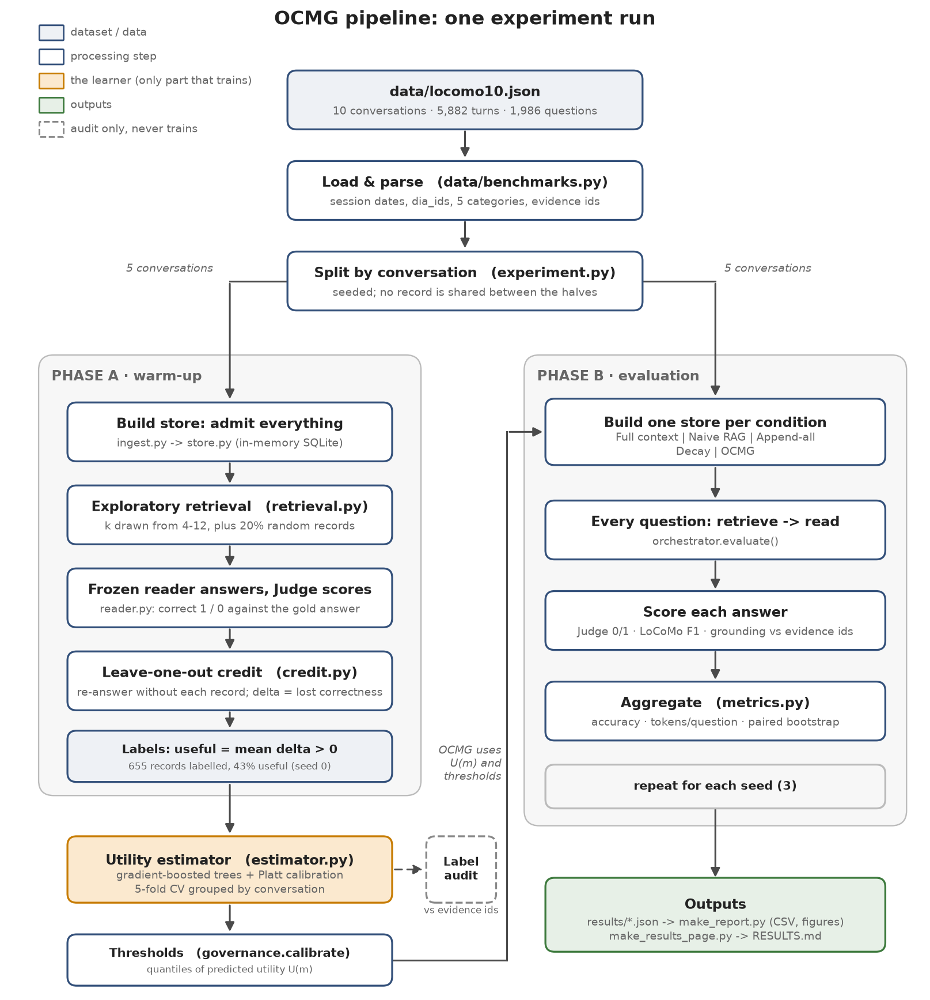
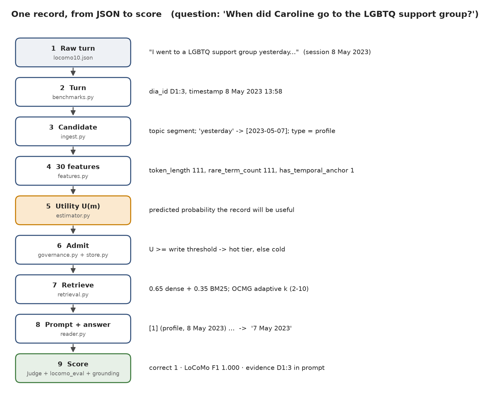
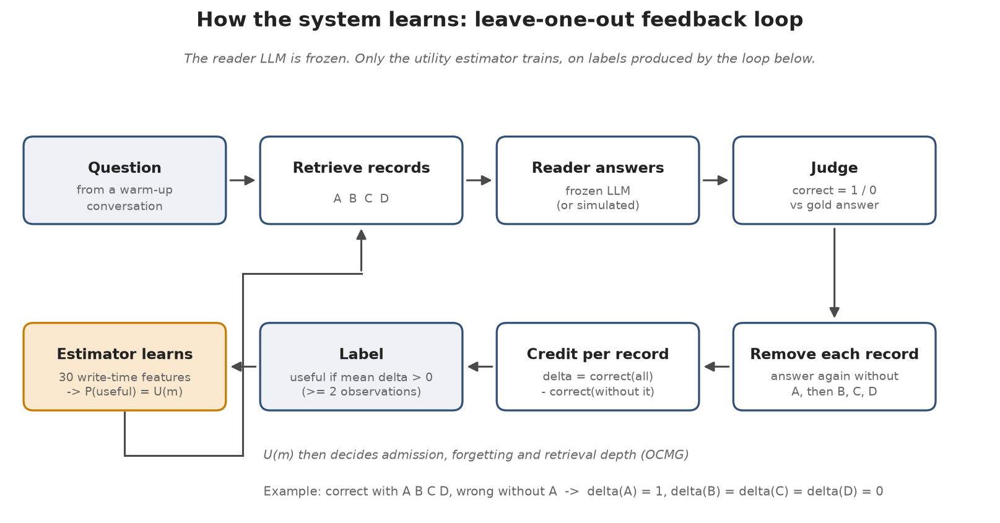
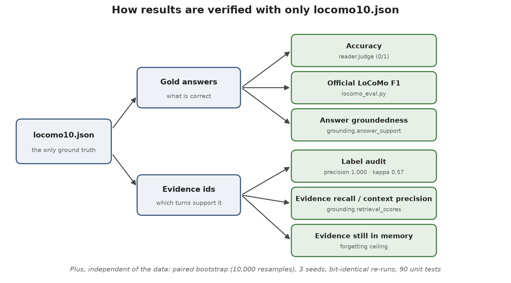

# OCMG pipeline flow

How LoCoMo data moves through the code, how each number in the terminal output
is calculated, and how results are checked using only `data/locomo10.json`.

Numbers are from `python scripts/run_experiment.py --dataset locomo --path data/locomo10.json --runs 1`
(seed 0, 21 Nov 2026). They come from the **simulated reader**, so they validate the
pipeline and are not thesis findings. The exception is the retrieval-level grounding
columns (evidence recall, context precision, evidence hit), which measure the store
and the retriever and hold for any reader.

Open in VS Code with `Ctrl+Shift+V` for the rendered preview. The diagrams are PNGs in
`docs/figures/`, drawn by `python scripts/make_flow_diagrams.py`, so they render without
any extension and can be pasted into slides or the thesis.

---

## 1. What we want to achieve

A memory-based agent stores conversation, retrieves part of it, and answers questions.
Deciding what to **keep** is done today with fixed rules (recency, decay) or by asking an
LLM about every item. Neither checks whether a memory ever helped produce a correct answer.

OCMG records that signal. It finds out which memories changed an answer, trains a cheap
classifier to predict that usefulness from a memory's own features, and uses the
prediction to decide admission, forgetting and retrieval depth.

| RQ | Question | Status (simulated reader) |
|---|---|---|
| RQ1 | Can outcomes train a utility estimator? | AUC 0.723, target 0.70 met. One feature alone (`rare_term_count`) gets 0.731, so the target cannot tell a model from a heuristic. |
| RQ2 | Do utility admission and forgetting beat decay and append-all? | Beats decay on every seed. Does not beat append-all at matched cost. |
| RQ3 | Does utility budgeting improve accuracy per token (95% / 40%)? | Not met. Iso-cost gap -0.0155 vs naive top-k, behind on all 3 seeds. |
| RQ4 | Cost saved vs per-item LLM judgement? | Gate built; needs a GPU run. |
| - | Leave-one-out credit | Strongest positive: AUC 0.727 vs 0.477 / 0.462 for the cheap credit rules. |

---

## 2. What we are leveraging

Everything OCMG builds on, what each piece does here, and where it lives in the code.
Nothing is trained except the utility estimator; everything else is used as it is.

### Data

| Resource | What it gives us | Used in |
|---|---|---|
| **LoCoMo** (`data/locomo10.json`, snap-research, ACL 2024) | 10 long two-person conversations, 272 dated sessions, 1,986 questions in 5 categories, each with a gold answer and **evidence ids** (the turns that support it) | `ocmg/data/benchmarks.py` |
| LoCoMo's official scorer (`task_eval/evaluation.py`) | the F1 that published papers report | replicated in `ocmg/locomo_eval.py` (0 mismatches on 15,888 pairs) |
| Synthetic conversations | fast, controlled data for tests and `--quick` rehearsals | `ocmg/data/synthetic.py` |

### Models (all frozen, none fine-tuned)

| Model | Role | Used in |
|---|---|---|
| **Llama-3.1-8B-Instruct** (default) / **Qwen2.5-1.5B-Instruct** (CPU probe) | the reader: answers questions from retrieved memory, greedy decoding | `ocmg/reader.py` `HFReader` (`--reader hf`) |
| **BAAI/bge-small-en-v1.5** | sentence embeddings for dense retrieval | `ocmg/embedding.py` (`--embedder sentence-transformers`) |
| Hashing embedder (256-d) | offline stand-in for bge-small; no download, deterministic | `ocmg/embedding.py` `HashingEmbedder` (default) |
| Simulated reader | probability model of a reader (right with p 0.92 if evidence present, 0.04 if not) so the pipeline runs on a CPU in minutes | `ocmg/reader.py` (default) |

### Libraries

| Library | What we use from it | Used in |
|---|---|---|
| **scikit-learn** | `HistGradientBoostingClassifier` (the estimator), `CalibratedClassifierCV` with sigmoid = Platt scaling, `StratifiedGroupKFold` (CV grouped by conversation), `permutation_importance`, `LogisticRegression` baseline, ROC-AUC / average precision / Brier / Cohen's kappa | `ocmg/estimator.py`, `ocmg/metrics.py` |
| numpy (scipy via scikit-learn) | vectors, similarity, bootstrap resampling | throughout |
| nltk | Porter stemmer, exactly as the official LoCoMo scorer uses it | `ocmg/locomo_eval.py`, `ocmg/grounding.py` |
| sqlite3 (Python standard library) | the memory store, in RAM: hot/cold tiers, outcome ledger | `ocmg/store.py` |
| transformers + torch + accelerate | load and run the frozen reader | `ocmg/reader.py` (`requirements-full.txt`) |
| sentence-transformers | load bge-small | `ocmg/embedding.py` (`requirements-full.txt`) |
| matplotlib | thesis figures, results page charts, these diagrams | `scripts/make_report.py`, `make_results_page.py`, `make_flow_diagrams.py` |
| pytest | 90 unit tests | `tests/` |

### Methods and techniques

| Technique | What it does in OCMG | Used in |
|---|---|---|
| **Leave-one-out credit** (counterfactual ablation) | answer again without each retrieved record; the record that flips a correct answer to wrong gets credit. This produces the training labels | `ocmg/orchestrator.py` `run_phase_a`, `ocmg/credit.py` |
| Exploration during warm-up | random k (4-12) plus 20% random records, so labels are not only for records the ranker already likes | `ocmg/retrieval.py` |
| Gradient-boosted trees + Platt calibration | turn 30 write-time features into a calibrated probability U(m) that a record will be useful | `ocmg/estimator.py` |
| Group cross-validation | 5 folds split by conversation, so no conversation is in both train and test | `ocmg/estimator.py` |
| Hybrid retrieval | 0.65 x dense cosine + 0.35 x BM25 (own BM25 implementation), each min-max normalised | `ocmg/retrieval.py` |
| Quantile thresholds | admission and forgetting cut-offs set at quantiles of U(m), not hand-picked values | `ocmg/governance.py` |
| Adaptive k | retrieve records within a share of the best score, 2-10 records, looser for temporal / list questions | `ocmg/retrieval.py` |
| Paired bootstrap | 10,000 resamples of the same questions, 95% CI and p-value for every comparison | `ocmg/metrics.py` |
| Cohen's kappa, precision/recall | audit the training labels against LoCoMo's evidence ids | `ocmg/metrics.py` |
| Iso-cost comparison | compare systems at the same token budget, so a cheaper system is not penalised for being cheaper | `scripts/sweep_budget.py` |
| Lexical grounding | evidence recall, context precision, answer support, hallucination rate, all from LoCoMo alone | `ocmg/grounding.py` |

### Compute

| Setting | Runs on | Purpose |
|---|---|---|
| simulated reader + hashing embedder | any laptop CPU, about 1 hour for the full set (`run_all.py`) | pipeline validation; every number in this document |
| real reader + bge-small | a CUDA GPU (CPU takes about 95 s per answer, about 35 h for 3 seeds) | the thesis findings |

---

## 3. Flow 1: one experiment run



### Step by step

Each step names the file that does it, what goes in, what comes out, and why it is done
that way.

**Step 1 · The dataset** (`data/locomo10.json`)
- *Input:* the LoCoMo release file.
- *Content:* 10 conversations between two people, 272 chat sessions spread over months,
  5,882 turns (1,226 of them share a photo, kept as its caption), 1,986 questions.
- Every question carries a **gold answer**, a **category** (single-hop, multi-hop, temporal,
  open-domain, adversarial) and **evidence ids**, the turns that support the answer.
- *Why this dataset:* it is the standard benchmark for long-term conversational memory, and
  its evidence ids let us check the system without any extra labelling.

**Step 2 · Load and parse** (`ocmg/data/benchmarks.py`, `load_locomo()`)
- *Input:* raw JSON.
- *Output:* a list of `Turn` objects (speaker, text, timestamp, `dia_id`) and `Question`
  objects (question, gold answer, category, evidence ids).
- Session dates such as "1:56 pm on 8 May, 2023" become timestamps, so relative dates
  like "yesterday" can be resolved later.
- Malformed evidence ids are cleaned; the 2 that point at turns missing from the release
  are dropped and reported.
- Adversarial questions have no answer, so their reference becomes
  "Not mentioned in the conversation": the correct behaviour is to abstain.
- *Check it:* `python scripts/verify_data.py` prints every count.

**Step 3 · Split by conversation** (`ocmg/experiment.py`, `split_conversations()`)
- *Output:* 5 warm-up conversations and 5 evaluation conversations, chosen by the seed.
- The split is by **whole conversation**, never by question. If the same conversation
  appeared on both sides, the estimator could memorise its records and look better than
  it is.
- Each seed gives a different split; 3 seeds are run and averaged.

**Step 4 · Phase A, build the store** (`ocmg/ingest.py` -> `ocmg/store.py`)
- *Input:* the warm-up conversations' turns.
- Filler turns ("haha", "ok") are removed. The rest are grouped into topic segments,
  relative dates are resolved ("yesterday" -> [2023-05-07]), and each segment is typed
  (profile, event, preference, ...) and embedded.
- *Output:* candidate memory records, all admitted. Nothing is filtered yet because there is
  no estimator yet.
- The store is SQLite **in RAM**: nothing survives between runs, so every seed starts clean.

**Step 5 · Phase A, exploratory retrieval** (`ocmg/retrieval.py`)
- For every warm-up question, the retriever picks records with a hybrid score
  (0.65 x embedding similarity + 0.35 x BM25 keyword score).
- The number of records k is drawn at random between 4 and 12, and 20% random records are
  mixed in.
- *Why explore:* if warm-up only retrieved what the ranker already likes, every label
  would describe those records only, and the estimator would learn the ranker's bias
  (the first marker's selection-bias point).

**Step 6 · Phase A, the reader answers and the Judge scores** (`ocmg/reader.py`)
- The frozen reader answers using all retrieved records.
- The Judge compares the answer with the gold answer: 1 = correct, 0 = wrong.
- Simulated reader: exact match. Real reader: token F1 >= 0.6. Adversarial: correct only if
  it abstains.

**Step 7 · Phase A, leave-one-out credit** (`ocmg/orchestrator.py`, `ocmg/credit.py`)
- The reader answers the same question again once per record, each time with that one
  record removed.
- delta(record) = correct with all records - correct without this record.
  delta = 1 means removing the record broke the answer, so it carried the answer.
- Deltas are collected for every record over all warm-up questions.

**Step 8 · Labels** (`run_phase_a`)
- A record is labelled **useful** if its average delta is above 0, given at least 2
  observations.
- *Output (seed 0):* 655 labelled records, 43.2% useful. These are the estimator's
  training rows.

**Step 9 · The utility estimator** (`ocmg/estimator.py`), **the only part that learns**
- *Input:* 30 features per record, computed when the record is written (length, number of
  entities, rare words, dates, similarity to existing records, ...), and the label.
- *Model:* gradient-boosted trees, then Platt calibration, so the output is an honest
  probability U(m) that the record will be useful.
- *Validation:* 5-fold cross-validation grouped by conversation. Seed 0: ROC-AUC 0.723.
- It never sees the question, the answer or the evidence ids, so it can score a record the
  moment it is written.

**Step 10 · Label audit** (`ocmg/metrics.py`, `label_validation()`), dashed in the diagram
- Compares the outcome labels with LoCoMo's evidence ids: precision 1.000, recall 0.658,
  kappa 0.569.
- *Audit only:* the evidence ids never become a feature or a training target. This is how
  the labelling method is shown to be trustworthy.

**Step 11 · Thresholds** (`ocmg/governance.py`, `calibrate()`)
- Admission and forgetting cut-offs are set as **quantiles** of the predicted utilities
  (for example "the lowest 25%"), not as hand-picked numbers.
- Current defaults: admission quantile 0.0 and forgetting quantile 0.0, both off, because
  the measurements showed that both hurt accuracy.

**Step 12 · Phase B, one store per condition** (`ocmg/experiment.py`, `run_all_conditions()`)
- The 5 evaluation conversations are stored five times, once per system:

  | Condition | How it stores and retrieves |
  |---|---|
  | Full context | no retrieval: the whole conversation goes into every prompt |
  | Naive RAG | 4-turn chunks, always the top 10 (the reference) |
  | Append-all | topic segments, keep everything, top 10 |
  | Decay | forgets by age and how rarely a record is retrieved |
  | OCMG | uses U(m) from step 9 and the thresholds from step 11, with adaptive k (2-10) |

- All five see the same questions, so their answers can be compared question by question.

**Step 13 · Every question: retrieve, then read** (`ocmg/orchestrator.py`, `evaluate()`)
- For each evaluation question and each condition, retrieve the records, build the prompt
  (`[i] (type, date) text`), and get the reader's answer.
- The memory word tokens sent are counted (`tok/q`).

**Step 14 · Score each answer**
- **Judge** 0/1 gives accuracy.
- **Official LoCoMo F1** (`ocmg/locomo_eval.py`) makes the numbers comparable with papers.
- **Grounding** (`ocmg/grounding.py`): was the gold evidence in the prompt (evidence recall),
  how much of the prompt was evidence (context precision), and are the answer's words in
  the prompt (groundedness)?

**Step 15 · Aggregate** (`ocmg/metrics.py`)
- Accuracy and tokens per question for each condition.
- A **paired bootstrap** (10,000 resamples of the same questions) decides whether OCMG's
  difference from each baseline is real: "no real difference" when the 95% CI includes 0.

**Step 16 · Repeat for each seed, then output**
- Steps 3-15 run once per seed (3 seeds), each with a new split and a newly trained
  estimator.
- *Output:* `results/*.json` holds every number. `make_report.py` turns it into CSV tables
  and figures; `make_results_page.py` builds `RESULTS.md`.

### The same flow as text

```
data/locomo10.json  (10 conversations, 5,882 turns, 1,986 questions)
        |
        v
ocmg/data/benchmarks.py  load_locomo()
   parse session dates, keep dia_id, clean evidence ids,
   map category 1-5 to names, adversarial reference = "Not mentioned in the conversation"
        |
        v
ocmg/experiment.py  split_conversations()   seeded, BY CONVERSATION
        |
        +---------------- 5 conversations ----------------+---- 5 conversations ----+
        |                                                                           |
        v                                                                           |
PHASE A  warm-up  (ocmg/orchestrator.py  run_phase_a)                               |
   build_store: admit every candidate        (ingest.py -> store.py)                |
   retrieve with exploration: k = 4..12, +20% random records  (retrieval.py)        |
   reader answers with all records           (reader.py)                            |
   LEAVE-ONE-OUT: answer again without each record                                  |
   label record useful if removing it cost a correct answer on average              |
        |                                                                           |
        |  655 labelled records, 43.2% useful                                       |
        v                                                                           |
ocmg/estimator.py  UtilityEstimator.fit()                                           |
   gradient-boosted trees + Platt calibration, 5-fold CV grouped by conversation    |
        |                                                                           |
        +--> metrics.label_validation()  labels vs LoCoMo evidence (audit only)     |
        |                                                                           |
        +--> governance.calibrate()  thresholds = quantiles of predicted utility    |
        |                                                                           v
        |                                    PHASE B  evaluation  (experiment.run_all_conditions)
        |                                       build one store per condition on the 5 test conversations
        |                                       Full context | Naive RAG | Append-all | Decay | OCMG
        +----------------------------------------------------------------------> OCMG uses the estimator
                                                                                    |
                                                                                    v
                                            orchestrator.evaluate()  for every question:
                                               retrieve -> reader answers -> Judge scores
                                               -> locomo_f1 (official score) -> grounding checks
                                                                                    |
                                                                                    v
                                            metrics.py  accuracy, tokens/query, paired bootstrap
                                                                                    |
                                                                                    v
                                            reporting.py -> results/*.json
                                            scripts/make_report.py -> results/tables/*.csv, figures/*.png
```

Nothing persists between runs: the store is SQLite in RAM. Each seed retrains from scratch.

**Why Phase A explores.** If warm-up retrieved only what the ranker already likes, the
estimator would learn from labels its own ranking produced. Random inclusions give other
records a chance to get an outcome. This partly addresses the first marker's
retrieval-selection-bias point; the with/without-exploration analysis is still to do.

---

## 4. Flow 2: one record, from JSON to score



### Step by step

This follows one real turn of `conv-26` through the system, for the question *"When did
Caroline go to the LGBTQ support group?"* (gold answer **7 May 2023**, temporal, evidence
`D1:3`).

1. **Raw turn.** In the JSON, Caroline says *"I went to a LGBTQ support group yesterday and
   it was so powerful."* in a session dated 8 May 2023. The answer is not written anywhere;
   it has to be worked out from "yesterday" plus the session date.
2. **Turn.** `benchmarks.py` gives it the id `D1:3` and a timestamp of 8 May 2023 13:58.
   Keeping the id is what lets every later check say whether this exact turn reached the
   prompt.
3. **Candidate.** `ingest.py` joins the six turns `D1:1`-`D1:6` into one topic segment and
   rewrites "yesterday" as "yesterday [2023-05-07]". The date is now in the text, so the
   reader does not need to calculate it. The segment is typed *profile*.
4. **30 features.** `features.py` describes the record with numbers only: 111 tokens,
   13 entities, a date anchor present, 111 rare terms, novelty 1.0. These are all available
   at write time, before any question is asked.
5. **Utility U(m).** The estimator turns the 30 numbers into a probability that this record
   will ever help answer a question.
6. **Admit.** If U(m) is at or above the admission threshold, the record goes to the hot tier
   (searched first); otherwise to the cold tier (still kept). With the current default
   (quantile 0.0), everything goes to the hot tier.
7. **Retrieve.** When the question arrives, the retriever scores every record of this
   conversation: 0.65 x embedding similarity + 0.35 x BM25. OCMG keeps the records scoring
   within 68% of the best (the looser setting for temporal questions), between 2 and 10
   of them.
8. **Prompt and answer.** The record appears in the prompt as
   `[1] (profile, 8 May 2023) ... support group yesterday [2023-05-07] ...`, followed by the
   question. The reader answers *"7 May 2023"*.
9. **Score.** The Judge marks it correct (1) and the official LoCoMo F1 is 1.000. Grounding
   finds `D1:3` in the prompt, so this question has evidence recall 1/1. Had the reader
   written "2023-05-07", it would score 0 under exact match: same meaning, different string.
   That is why the real-reader judge uses token F1.

### The same journey as text

Turn `D1:3`, conversation `conv-26`. Question: *"When did Caroline go to the LGBTQ
support group?"*, gold answer **7 May 2023**, category 2 (temporal), evidence `["D1:3"]`.

```
STEP 1  raw file                                            data/locomo10.json
   {"speaker": "Caroline", "dia_id": "D1:3",
    "text": "I went to a LGBTQ support group yesterday and it was so powerful."}
   session_1_date_time = "1:56 pm on 8 May, 2023"
        |
STEP 2  Turn                                                benchmarks.load_locomo
   session 1, turn 2, timestamp 8 May 2023 13:58 (turns 1 minute apart), dia_id kept
        |
STEP 3  Candidate                                           ingest.build_candidates
   drop filler -> split at topic boundaries -> resolve "yesterday" -> type -> embed
   six turns D1:1..D1:6 became one candidate, type = profile
   text: "... support group yesterday [2023-05-07] and it was so powerful ..."
        |
STEP 4  30 features                                         features.extract_features
   token_length 111, n_entities 13, has_temporal_anchor 1, rare_term_count 111, novelty 1.0
        |
STEP 5  admission                                           governance + store.admit
   OCMG: estimator predicts U; U >= write threshold -> hot tier, else cold tier.
   write_quantile = 0.0 (measured optimum) -> nothing demoted.
        |
STEP 6  retrieval                                           retrieval.Retriever
   same conversation only; score = 0.65 x dense cosine + 0.35 x BM25 (each min-max)
   OCMG: adaptive k, keep records >= 80% of best (68% temporal, 64% enumerative), 2..10
        |
STEP 7  prompt                                              reader.HFReader._prompt
   [1] (profile, 8 May 2023) Hey Mel! ... support group yesterday [2023-05-07] ...
   QUESTION: When did Caroline go to the LGBTQ support group?
        |
STEP 8  score                                               reader.Judge + locomo_eval
   "7 May 2023"  -> correct 1, LoCoMo F1 1.000
   "2023-05-07"  -> correct 0, LoCoMo F1 0.000
```

---

## 5. How the system learns (the LLM does not)



### Step by step

A common question is "how does the LLM learn what to store?" It does not. The LLM is the
same before and after. What learns is a small classifier, and this loop is where its
training data comes from.

1. **Question.** Take a question from a warm-up conversation. Its gold answer is known.
2. **Retrieve records.** Retrieve several records, say A, B, C and D (with exploration, so
   the set is not always the ranker's favourites).
3. **Reader answers.** The frozen reader answers with all four records in the prompt.
4. **Judge.** Is the answer correct? Suppose yes: correct(all) = 1.
5. **Remove each record.** Ask the same question four more times, each time with one record
   missing: without A, without B, without C, without D.
6. **Credit per record.** Compare each answer with the full one:
   - without A the answer became wrong: delta(A) = 1 - 0 = 1, so A carried the answer;
   - without B, C or D it stayed correct: delta = 0, so they were not needed.
7. **Label.** Over all warm-up questions, a record whose average delta is above 0 (seen at
   least twice) is labelled useful (1), otherwise not useful (0).
8. **Estimator learns.** The gradient-boosted trees learn which write-time features predict
   label 1. In this data the strongest signal is how many rare words a record contains.
9. **Back to the store.** In Phase B the trained estimator scores every new record the moment
   it is written. That score U(m) is what OCMG uses to decide admission (hot or cold tier),
   forgetting (evict the lowest) and retrieval depth.

**Why leave-one-out rather than a simpler rule?** Cheaper rules give credit by rank (the
top-ranked record gets the most) or share it equally. Measured on the same data, those labels
train an estimator with AUC 0.477 and 0.462, worse than chance. Leave-one-out labels reach
0.727. This is the strongest positive result so far.

**What it costs:** one extra reader call per retrieved record, during warm-up only. Phase B
does no leave-one-out.

### The loop as text

The reader LLM is **frozen**: same weights, greedy decoding, no fine-tuning. The thing that
learns is the **utility estimator** in `ocmg/estimator.py`, a gradient-boosted tree classifier.

Its labels come from **leave-one-out** in `orchestrator.run_phase_a`:

```
question  ->  retrieve records A B C D
answer with A B C D            -> judge -> correct(all) = 1
answer with   B C D (no A)     -> judge -> 0    delta(A) = 1 - 0 = 1   A carried the answer
answer with A   C D (no B)     -> judge -> 1    delta(B) = 0
answer with A B   D (no C)     -> judge -> 1    delta(C) = 0
answer with A B C   (no D)     -> judge -> 1    delta(D) = 0

after all warm-up questions:
   label(record) = 1  if mean delta > 0   (needs >= 2 observations, loo_min_observations)
```

The estimator then learns `30 write-time features -> label`. It never sees the question,
the answer or the evidence annotation, so it can score a record the moment it is written.

What it learned: mostly lexical rarity. `rare_term_count` has the highest permutation
importance (0.126), and ranking by that one feature gives AUC 0.731, slightly above the
model's 0.723.

---

## 6. How precision and recall are calculated

Three different precision/recall pairs appear in the output. They answer different questions.

### 6a. Label audit (section 4 of the output): are the training labels right?

`ocmg/metrics.py  label_validation()`. For each of the 655 labelled records:

- outcome label `y` = 1 if leave-one-out said it was useful
- evidence label `e` = 1 if the record contains a turn LoCoMo lists as evidence for any question

`e` is **never** a feature and **never** a training target. It is used only here.

```
                         evidence e = 1     evidence e = 0
outcome y = 1 (useful)       TP = 283           FP = 0
outcome y = 0                FN = 147           TN = 225

precision = TP / (TP + FP) = 283 / 283 = 1.000   every record called useful really holds evidence
recall    = TP / (TP + FN) = 283 / 430 = 0.658   two thirds of evidence records were credited

Cohen's kappa = (p_o - p_e) / (1 - p_e)
   p_o = (TP + TN) / n = (283 + 225) / 655 = 0.776                    observed agreement
   p_e = 0.432 x 0.656 + 0.568 x 0.344 = 0.479                        agreement expected by chance
   kappa = (0.776 - 0.479) / (1 - 0.479) = 0.569
```

Read the two asymmetrically. **Low precision would refute the method**: it would mean credit
lands on records that do not support any answer. Low recall is expected: a record can hold
evidence and never change an answer because another retrieved record carried the same fact.

`estimator vs evidence 0.779 ROC-AUC` scores the trained model's out-of-fold predictions
directly against `e`.

### 6b. Retrieval grounding (section 9, new): did the prompt contain the evidence?

`ocmg/grounding.py  retrieval_scores()`, per answerable question:

```
gold = the question's evidence ids, e.g. {D1:2, D3:1, D9:9}
sent = records in the prompt, each with source_ids

evidence recall    = |gold ids found in any sent record| / |gold|
                     e.g. D1:2 and D3:1 found, D9:9 missing -> 2/3
context precision  = sent records holding >= 1 gold id / number of sent records
                     e.g. 2 of 4 records relevant -> 0.50
evidence hit       = 1 if any gold id was found, else 0
```

Adversarial questions have no evidence, so they are excluded from these three rather than
scored zero.

### 6c. Average precision (section 3)

`avg precision` is scikit-learn's average precision of the estimator's out-of-fold
probabilities: precision averaged over every recall level as the threshold moves.

---

## 7. How tokens are determined

```
ocmg/embedding.py   tokenize(text) = regex [a-z0-9']+ on lowercased text
ocmg/ingest.py      count_tokens(text) = len(tokenize(text))

"I went to a LGBTQ support group yesterday [2023-05-07] and it was so powerful."
 -> i went to a lgbtq support group yesterday 2023 05 07 and it was so powerful  = 16 tokens
```

- **Retrieval conditions:** `retrieval.py` line ~259, `prompt_tokens = sum(count_tokens(record.text) for chosen records)`.
- **Full context:** `orchestrator.evaluate`, the same sum over every active record in the conversation.
- **Not counted:** the instruction text, the question, and the `[i] (type, date)` header on each
  record. These are the same per record for every condition, so comparisons stay fair, but the
  absolute numbers are below what the model actually reads.
- These are **word tokens, not model tokens**. Llama and Qwen use subword tokenizers, which give
  more tokens for the same text. The ratio has not been measured; write "word tokens" in the thesis.

`tok/q` in the output = mean `prompt_tokens` over all questions of that condition.

**Context window**: the model's maximum prompt length (Llama-3.1-8B: 128K, Qwen2.5-1.5B: 32K).
Full context is ~14,095 word tokens per question; retrieval is 1,259-1,868. Long prompts help
multi-hop questions but make the reader answer adversarial questions it should refuse, and on
CPU generation time follows prompt length (~95 s for an ~1,100-token prompt).

---

## 8. How accuracy works, and where it is configured

**Configured in one place:** `ocmg/config.py  EvalConfig` (reached as `cfg.evaluation`).

| Field | Default | Effect |
|---|---|---|
| `judge` | `"auto"` | `exact` with the simulated reader, `f1` with a real reader |
| `f1_threshold` | `0.6` | with `f1`, an answer is correct when token F1 >= 0.6 |
| `grounded_support_threshold` | `0.5` | used by the grounding check, not by accuracy |

**The chain, file by file:**

```
reader.Judge.score(prediction, reference)            one question -> 0 or 1
   if reference is an abstention (adversarial):
       correct = 1 only if the prediction abstains   regex: not mentioned, don't know, ...
   elif judge == "exact":  correct = lower(prediction) == lower(reference)
   elif judge == "f1":     correct = token_f1(prediction, reference) >= f1_threshold
        |
orchestrator.evaluate()                              collects the 0/1 per question and per category
        |
metrics.accuracy(flags) = mean(flags)                "acc" column
        |
metrics.paired_bootstrap(ocmg_flags, other_flags)    10,000 resamples of the same questions
   delta = mean(ocmg) - mean(other); 95% CI = 2.5th..97.5th percentile
   p = 2 x share of resamples on the other side of zero
        |
scripts/make_report.py -> results/tables/main_results.csv
```

Token F1 example: prediction "May 2023", reference "7 May 2023" -> 2 shared tokens,
precision 2/2, recall 2/3, F1 = 0.8 -> correct at threshold 0.6.

**Official LoCoMo F1** (`ocmg/locomo_eval.py`) is computed on the same answers and reported
beside accuracy. It reproduces the authors' `task_eval/evaluation.py` (0 mismatches on 15,888
pairs) so numbers can be compared with published papers. It never feeds training.

---

## 9. How results are verified with only locomo10.json



### Step by step

The only ground truth is `locomo10.json`. It gives two things, and each check below is
built on one of them.

**From the gold answers (what is correct):**
1. **Accuracy** (`reader.Judge`): each answer scored 1 or 0 against the gold answer; the
   `acc` column is the share of 1s.
2. **Official LoCoMo F1** (`ocmg/locomo_eval.py`): the same answers under the scorer the
   LoCoMo authors published, reproduced exactly, so numbers can be put next to published
   papers.
3. **Answer groundedness** (`grounding.answer_support`): what share of the answer's content
   words appear in the prompt it was given. An answer whose words are not in its prompt was
   made up or guessed. This is the reproducible stand-in for "faithfulness".

**From the evidence ids (which turns support the answer):**

4. **Label audit** (`metrics.label_validation`): do records the system labelled useful really
   contain evidence? Precision 1.000 means every one does.
5. **Evidence recall and context precision** (`grounding.retrieval_scores`): of the turns
   needed, how many reached the prompt, and of what was sent, how much was relevant. These
   do not depend on the reader at all, so they are valid even with the simulated reader.
6. **Evidence still in memory** (forgetting ceiling, `compare_forgetting.py`): after
   forgetting, what share of the needed evidence is still stored. If it is gone, no reader
   can answer.

**Independent of the data:**
- **Paired bootstrap:** is a difference bigger than chance?
- **3 seeds:** does it hold on different splits?
- **Bit-identical re-runs:** the same seed always gives the same numbers.
- **90 unit tests:** every component behaves as specified.

### All checks in one table

LoCoMo gives two kinds of ground truth: the **gold answer** and the **evidence ids** (which
turns support it). Everything below uses only those, the code and statistics.

| Check | What it verifies | Where | Seed 0 |
|---|---|---|---|
| Data verification | counts, dates, malformed ids match the release | `scripts/verify_data.py` | 10 / 272 / 5,882 / 1,986 |
| Answer correctness | answer vs gold answer | `reader.Judge` | acc column |
| Official comparability | same answers under the authors' scorer | `locomo_eval.py` | LoCoMo F1 column |
| Label audit | training labels vs evidence ids | `metrics.label_validation` | precision 1.000, kappa 0.569 |
| **Retrieval grounding** | was the gold evidence in the prompt? | `grounding.retrieval_scores` | OCMG evidence recall 66.4% |
| **Answer groundedness / faithfulness** | are the answer's words in its prompt? | `grounding.answer_support` | OCMG grounded 96.4% |
| **Hallucination** | answered without abstaining and not grounded | `grounding.GroundingTracker` | OCMG 1.7% |
| Statistical significance | is a difference real? | `metrics.paired_bootstrap`, 3 seeds | CI and p column |
| Fair comparison | accuracy at matched token cost | `scripts/sweep_budget.py` | -0.0155 vs naive |
| Reproducibility | same seed, same numbers | re-run seed 0 | bit-identical |
| Unit tests | every component in isolation | `python -m pytest` | 90 pass |
| Inspection | graded answers kept verbatim | `_samples` in the results JSON | 24 kept |

### Grounding output, seed 0 (section 9 of the terminal output)

```
condition          ev recall  ctx prec  ev hit  grounded  halluc  lucky  misread
Full context          100.0%      1.5%  100.0%     98.6%    0.8%           7        89
Naive RAG (top-k)      69.3%      8.7%   77.5%     96.9%    1.5%          12        38
Append-all typed       72.0%      9.2%   80.3%     97.7%    1.2%           9        38
Decay-based            62.1%      8.1%   70.6%     97.4%    1.2%           6        35
OCMG                   66.4%     17.7%   74.5%     96.4%    1.7%          11        26
```

How to read it:
- **Full context** always has 100% evidence recall (everything is in the prompt) and the
  worst context precision (1.5%): 89 answers were wrong although the evidence was right
  there. The reader is drowning in context.
- **OCMG** has the highest context precision (17.7%, about double the others): what it sends is
  more relevant. But its evidence recall (66.4%) is below naive RAG (69.3%) and append-all
  (72.0%): it sends less of the needed evidence. This holds for any reader, and it is the
  mechanism behind the iso-cost result.
- The four answer outcomes:

```
                     grounded                       not grounded
correct      the system worked                lucky: right without support
wrong        misread: evidence there,         evidence missing, or made up
             reader misread it
```

### Limits of these checks (say them in the thesis)

- **Groundedness is lexical.** It checks whether the answer's content words (stemmed, function
  words removed) appear in the prompt. A derived date ("yesterday" in a session on 8 May ->
  "7 May 2023") shares few words with its context, so temporal answers under-report.
- **Faithfulness in the RAGAS sense** (each claim entailed by the context) needs a second model
  as judge. That is the Step 4 LLM-judge item; the lexical score is the reproducible proxy.
- **Under the simulated reader** a correct answer is the gold text itself, so the answer-level
  columns (grounded, halluc, quadrants) test only the machinery. The retrieval columns (ev
  recall, ctx prec, ev hit) do not depend on the reader and are valid now.

---

## 10. File map

| Stage | File | What it decides | In -> out |
|---|---|---|---|
| data | `ocmg/data/benchmarks.py` | LoCoMo parsing: dates, dia_ids, categories, abstention reference, evidence cleaning | JSON -> Turn, Question |
| data | `ocmg/data/synthetic.py` | synthetic data for tests and `--quick` | seed -> Turn, Question |
| config | `ocmg/config.py` | every parameter, with the measurement that set it; `EvalConfig` for scoring | - |
| types | `ocmg/types.py` | data classes between stages; `RunResult` | - |
| 1 ingest | `ocmg/ingest.py` | filler removal, topic segmentation, date resolution, typing, token counting | Turn -> Candidate |
| 1 ingest | `ocmg/embedding.py` | hashing or bge-small embedder; the tokenizer | text -> vector |
| 2 admit | `ocmg/features.py` | 30 write-time features; `features_for` is the only feature path | Candidate -> 30 floats |
| 2 admit | `ocmg/estimator.py` | the learner: GBDT, calibration, group CV, baselines, importance | features + labels -> U(m) |
| 2 + 5 | `ocmg/governance.py` | dedup, quantile thresholds, admit, forgetting | U(m) -> admit / demote / evict |
| 3 store | `ocmg/store.py` | in-memory SQLite, hot/cold tiers, dense index, ledger | Candidate -> Record |
| 4 retrieve | `ocmg/retrieval.py` | dense + BM25 fusion, utility rerank, adaptive k, exploration, token sum | Question -> records |
| 4 read | `ocmg/reader.py` | simulated and HF readers, prompt, generative gate, Judge | records -> answer, 0/1 |
| score | `ocmg/locomo_eval.py` | official LoCoMo scorer replica | answer -> F1 |
| score | `ocmg/grounding.py` | evidence recall/precision, answer support, hallucination | answer + prompt -> rates |
| 5 credit | `ocmg/credit.py` | leave-one-out, rank-weighted, uniform, top-1 credit | outcome -> ledger |
| run | `ocmg/orchestrator.py` | Phase A with LOO labels, threshold calibration, `evaluate()` loop | conversations -> RunResult |
| run | `ocmg/experiment.py` | builds every condition, decay policy, ablations, terminal summary | config -> results |
| score | `ocmg/metrics.py` | accuracy, bootstrap, label audit, per-category AUC, iso-cost | flags -> numbers |
| report | `ocmg/reporting.py`, `ocmg/console.py` | results JSON with `reportable` flag; terminal formatting | results -> JSON / text |
| scripts | `run_experiment.py`, `run_all.py` | one run, or every experiment | CLI -> results/*.json |
| scripts | `sweep_budget.py`, `compare_forgetting.py` | iso-cost frontier, gate and forgetting sweeps | CLI -> results/*.json |
| scripts | `make_report.py`, `make_dashboard.py` | CSV tables incl. `grounding.csv`, 300-dpi figures, dashboard | JSON -> CSV / PNG |
| scripts | `verify_data.py`, `check_features.py` | dataset checks; constant features | data -> checks |
| scripts | `make_results_page.py` | one readable page, `results/full/RESULTS.md`, with 4 charts | JSON -> Markdown / PNG |
| scripts | `make_flow_diagrams.py` | the four diagrams in this document | - -> `docs/figures/*.png` |

---

## 11. Commands to show the flow live

```powershell
.\.venv\Scripts\Activate.ps1
python scripts/verify_data.py                     # the dataset, counted and checked
python -m pytest tests/                           # 90 tests
python scripts/run_experiment.py --dataset locomo --path data/locomo10.json --runs 1
python scripts/make_report.py                     # tables incl. results/tables/grounding.csv
python scripts/make_results_page.py               # results/full/RESULTS.md, open with Ctrl+Shift+V
python scripts/make_flow_diagrams.py              # redraw the diagrams in docs/figures/
python scripts/make_demo_pack.py                  # demo/: this document, the results and both runs as 4 PNGs
```

The run prints sections 1-9. Every single number has its meaning on the same line. Every
table has a one-line definition of its columns above it and a plain-language reading at
the end of each row.
